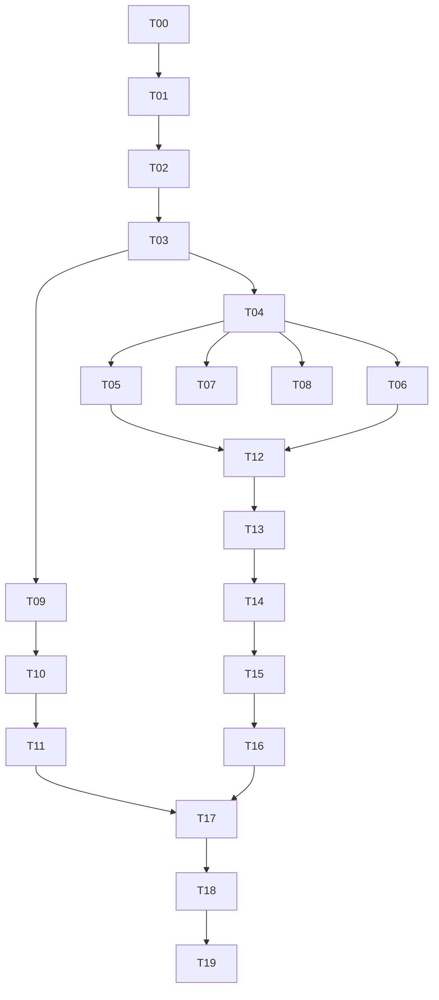

# T01 产品与架构基线

主责 R01、R02、R03、R08；评审 R11、R14、R16、R23、R26。输入为用户 V4.0 指令与 T00 空目录审计。

## 首期产品目标

目标用户是研究人员和内部信息分析人员。第一价值是从官方来源取得原始消息、保留实际时间与证据、在中文界面可追溯阅读。第一期不下单，不承诺收益，不展示未获授权行情。用户流程：配置本地服务 → 核验来源许可 → 开启采集 → 查看事件 → 查看证据版本 → 打开官方原文。模型未配置时显示原文并明确说明翻译尚未配置。

一级菜单按用户指令保留12项。首期实现总览、实时情报、证据查询、来源监控和系统配置状态；其余显示未接入。所有计数从数据库查询，不使用装饰性金融数字。

## ADR-001 架构

采用 Java 21、Spring Boot 3.5.16、PostgreSQL 16+、Flyway、WebClient、Spring Security、Spring Scheduler、Vue 3、TypeScript、Vite。Spring 官方兼容要求见 https://docs.spring.io/spring-boot/3.5/system-requirements.html 。工程使用 Maven Central HTTPS 仓库，不修改机器全局 Maven 设置。

模块化单体：collector 负责 HTTP/解析/任务；evidence 负责事务持久化；event 负责分页查询；stream 负责持久化 Outbox 补读；security 负责认证。后续宏观、实体、关系、AI、预警在各自门禁满足后加入。数据库不得用 H2 替代正式 PostgreSQL 验收。

## 任务依赖与门禁

首期闭环依赖 T02/T03/T04/T05或T06/T09/T10/T11，必须通过真实数据库和外部 HTTP 门禁。T17 安全审查贯穿开发。没有配置 Key/许可的任务保持阻塞，继续不依赖该配置的工作。

## 数据与安全契约

事实级别 L0 官方、L1 原创、L2 聚合；AI 输出独立，不能升级事实。证据保存原始响应字节和 SHA-256；发布时间缺失保持空并记录原因。事件元数据指纹与原始字节哈希分开：仅该条标题、链接、发布时间、类别或标识变化才创建版本，避免RSS新增其他条目制造全量修订。版本标为元数据变化，不能声称官方原文全文已发生修订；首期不额外抓取正文。

来源许可必须记录访问、存储、展示、依据、时间、有效期；过期自动阻断采集。已核实证据需要 L0、有发布时间、合法许可、实际字节哈希。写入由服务控制；数据库保护原始证据不可更新和删除。

API 默认 POST 查询及写操作；SSE 是 GET。全部业务 API 需要 Bearer 密钥，密钥不存浏览器持久化，不放URL。无 Cookie 认证，CSRF关闭；管理角色可访问原始证据。仅回环监听，Vite 同源代理。尚未提供多用户权限和密钥轮换管理，不能作为公网部署版本。

容量基线：单进程共享 HTTP 客户端每秒最多2请求；最多50个 SSE 客户端；每轮每客户端最多100条；事件每页50条；响应最大4MiB；来源至少60秒周期，首期300秒。以上是实现上限，不是性能测量结果。默认单后端实例，不支持多副本分布式调度。

## 实际设计审查

R01：先交付可溯源官方事件，其他菜单明确不可用。R08：公开可访问不等于商业再分发许可，默认关闭。R11：数据库事务 Outbox 支持编号补读，客户端发送成功不等于用户阅读确认。R14：先建立核心库，不用空表冒充高级能力。R16：实际字节哈希和数据库门禁不可省略。R23：禁止任意用户URL，禁止跳转，XML禁用外部实体。R26：单元测试与真实闭环分开验收。

剩余风险：来源DNS变化、复杂 SEC 历史分页、单次响应复制给多个证据导致存储冗余、Outbox保留策略、长期稳定性、多用户授权、集群统一限流、翻译质量、数据许可细节、全球限流及异常恢复仍需后续验收。
