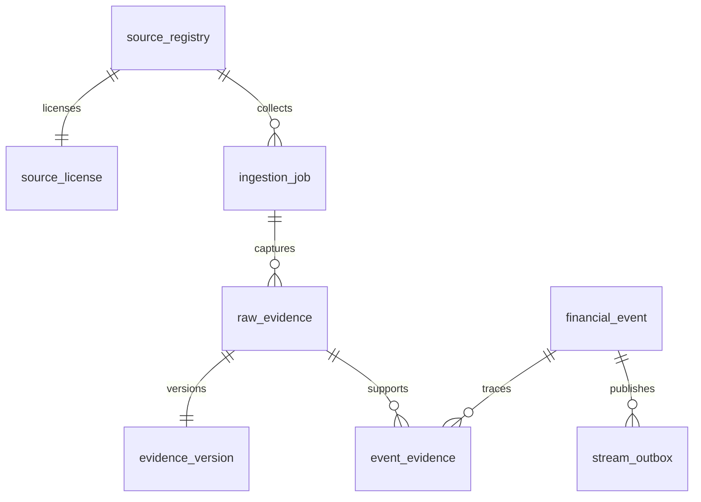

# 数据库与证据设计

主责 R14/R15/R16；实际迁移 backend/src/main/resources/db/migration/V1-V3。正式 PostgreSQL 迁移尚未执行，不把SQL静态检查视为数据库验收。

核心表：source_registry、source_license、ingestion_job、source_cursor、raw_evidence、evidence_version、financial_event、event_evidence、ingestion_quarantine、stream_outbox、source_health_history、audit_log。高级实体/关系/宏观/行情/AI/预警表尚未实施。

证据包含来源、文档标识、原始URL、发布时间、缺失时间原因、首次发现、实际入库、原始字节、字节SHA-256、事件元数据指纹、语言、解析器、修订、核验状态、任务。哈希由实际字节计算，PostgreSQL触发器重复校验；原始证据不可更新/删除。数据库触发器保护任务与来源绑定，官方URL对应官方域名，VERIFIED只允许已许可L0且发布时间存在。SQL哈希函数依据 [PostgreSQL16官方二进制函数文档](https://www.postgresql.org/docs/16/functions-binarystring.html)，锁依据 [官方锁文档](https://www.postgresql.org/docs/16/explicit-locking.html)，文档核验不能代替实际迁移测试。

相同最新元数据不创建重复事件版本；同一文档变化生成新证据和Outbox，事件当前指针切换，历史不覆盖。恢复到更早元数据仍生成新的修订。首次发现保留首版本的时间，不能拿采集时间代替发布时间。SEC acceptanceDateTime 用于申报可获得时刻，未使用仅日期字段冒充精确发布时间。

数据库事务把证据、版本、事件、关联和Outbox共同提交。事务全局 advisory lock 保证Outbox序号分配与提交顺序一致，单来源锁确保修订不冲突。首版针对单节点，锁吞吐与多节点调度未经压测。

保留策略、分区、原始响应批次去重存储、删除治理、正式备份恢复演练尚未完成。原始响应可能为每条事件重复保存，需要后续引入批次blob引用减少存储。不可用数据库假装执行成功。
